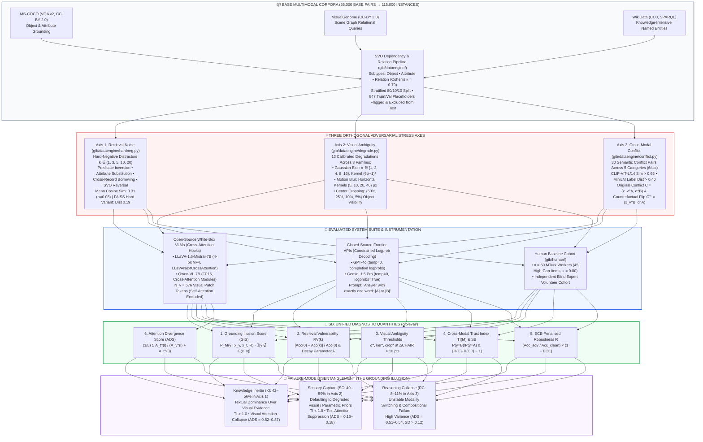
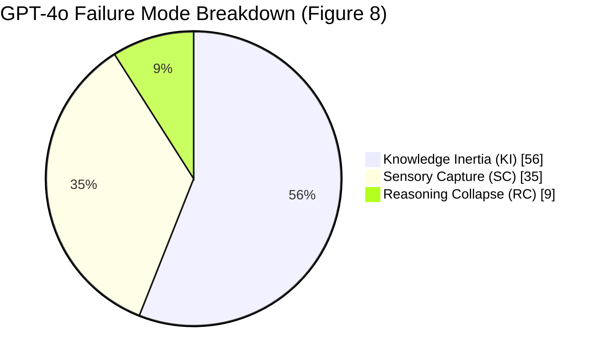
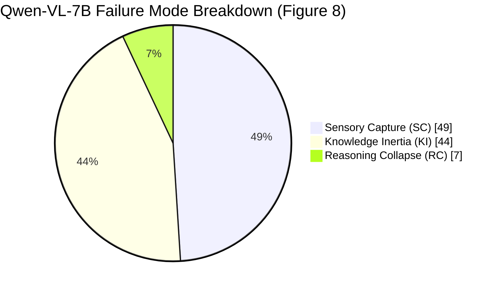

<div align="center">

# 👁️ The Illusion of Grounding: GIB-115K, a Diagnostic Benchmark for Multimodal RAG under Retrieval Noise, Visual Ambiguity, and Cross-Modal Conflict

### *Three-Axis Adversarial Stress Testing, Failure-Mode Disentanglement & Cross-Attention Attribution for Vision-Language Models (Work in Progress)*

**Axis 1: Retrieval Noise (`k ∈ {1, 3, 5, 10, 20}`) • Axis 2: Visual Ambiguity (`σ ∈ {1..16}`, Motion Blur, Cropping) • Axis 3: Cross-Modal Conflict (`TI` & Counterfactual Symmetry) • Six Diagnostic Quantities • Real Cross-Attention Hook Introspection (`ADS`)**

[](#)
[-2563EB?style=for-the-badge&logo=databricks&logoColor=white)](#4-gib-115k-benchmark-construction--dataset-schema)
[](#3-problem-formulation--six-diagnostic-quantities)

[-059669?style=for-the-badge)](#61-clean-baseline--the-accuracy-robustness-pareto-frontier-table-1)
[-DC2626?style=for-the-badge)](#7-human-baseline-study--metacognitive-gap-table-4)
[-0D9488?style=for-the-badge)](#8-mechanistic-interpretability-cross-attention-divergence-analysis-table-5)
[%20%7C%20APACHE%202.0%20(CODE)-1E293B?style=for-the-badge)](#10-repository-architecture--module-map)

</div>

---

*GIB-115K: A unified diagnostic benchmark evaluating Multimodal RAG under retrieval noise, visual ambiguity, and cross-modal conflict (Work in Progress).*

<br>

> **📌 Project Status Note (Work in Progress):** This repository contains the dataset generation engine (`gib/dataengine/`), multi-axis evaluation harness (`gib/eval/`), cross-attention interpretability hooks (`gib/interp/`), human baseline annotation suite (`gib/human/`), and Parquet evaluation releases (`data/gib15k/variants/`) for **GIB-115K (Work in Progress)**. Extended threshold-sensitivity sweeps, encoder-swap ablations, and pretraining contamination audits are actively being integrated.

Retrieval-Augmented Generation (RAG) has become a standard mechanism for improving factual grounding in vision-language models (VLMs), yet its behaviour under adversarial conditions remains insufficiently characterised. Existing hallucination suites evaluate single failure dimensions in isolation—addressing object hallucination in captions (`CHAIR`), binary object presence probing (`POPE`), attribute/relation errors (`MMHal-Bench`), compositional premises (`HaloQuest`), or visual-language illusions without retrieval noise (`HallusionBench`).

We introduce **GIB-115K (Grounding Illusion Benchmark)**, a dataset of **115,000 image-QA pairs** derived from **MS-COCO**, **VisualGenome**, and **WikiData** (built from **55,000 base image-QA pairs** with three adversarial variants per instance), designed to evaluate VLMs across **three orthogonal stress axes**:
1. **Axis 1 — Retrieval Noise:** Hard-negative distractors at dosage levels **k ∈ {1, 3, 5, 10, 20}**.
2. **Axis 2 — Visual Ambiguity:** Calibrated Gaussian blur (**σ ∈ {1, 2, 4, 8, 16}**), horizontal motion blur (**{5, 10, 20, 40} px**), and progressive center cropping (**{50, 25, 10, 5}%** object visibility).
3. **Axis 3 — Cross-Modal Conflict:** Intentional image-text semantic mismatches paired with counterfactual label probing (**C** vs. **C<sup>−1</sup>**).

These three stressors expose three distinct failure modes—**Sensory Capture (SC)**, **Knowledge Inertia (KI)**, and **Reasoning Collapse (RC)**—which together constitute the **Grounding Illusion**: *confident responses grounded in corrupted evidence*.

---

## ⚡ Executive Empirical Scorecard at a Glance

| Diagnostic Pillar / Stress Axis | Experimental Protocol & Scope | Primary Quantitative Finding | Core Scientific & Architectural Verdict |
| :--- | :--- | :--- | :--- |
| **Clean Baseline & Pareto Dissociation** (`Table 1`, `Figure 3`) | 4 VLMs (`LLaVA-1.6-7B`, `Qwen-VL-7B`, `GPT-4o`, `Gemini 1.5 Pro`) + Human (`n = 50`) + unimodal ablations | `GPT-4o` highest clean Acc (**`79.1%`**) but lowest **R<sub>agg</sub> = `0.366`**; `Qwen-VL` highest **R<sub>agg</sub> = `0.552`** despite **`7.7 pp`** lower clean Acc | Clean accuracy is a poor proxy for adversarial robustness (**Cohen's *d* = `1.24`**, 95% CI `[0.98, 1.50]`); both closed-source models lie off the Pareto frontier. |
| **Axis 1: Retrieval Noise Vulnerability** (`Figure 1`, `Table 8`) | Hard-negative distractors at `k ∈ {1, 3, 5, 10, 20}`; exponential decay fit (`R² > 0.97`) & one-way ANOVA at `k = 20` | At `k = 20`, `GPT-4o` loses **`61.8%`** of clean accuracy (`RV(20) = 62.6%` envelope) vs. **`42.7%`** (`46.7%` envelope) for `Qwen-VL`; Human **`RV(20) = 0.089`** (`7.7%`, **λ = `8.12`**) | Significant cross-system divergence (**`F(4, 95) = 12.34, p < 0.001, η² = 0.34`**); human distractor sensitivity parameter **λ = `8.12`** exceeds AI models (`2.14–2.89`) by **~3×**. |
| **Axis 2: Visual Ambiguity & Super-Additivity** (`Figure 2`, `Table 2`) | 13 degraded variants: Gaussian blur `σ ∈ {1..16}`, motion blur `{5..40} px`, crop `{50..5}%` + Axis 1×2 permutation test | `Qwen-VL` achieves **`σ* = 8`** and **`ker* = 20 px`** (**2×** all other models at `σ* = 4`, `ker* = 10 px`); at `5%` crop, AI drops **`40–55 pp`** vs. **`3 pp`** for humans | Combined high blur (`σ = 8`) + high distractors (`k = 10`) increases `CHAIR`<sub>`s`</sub> by **`8–14 pp` beyond additivity** (**`p < 0.001`**, 10,000 shuffles), proving super-additive stressor interaction. |
| **Axis 3: Cross-Modal Conflict & Modality Bias** (`Figure 4`, `Table 3`) | 30 conflict pairs across 5 categories (`animals`, `vehicles`, `food`, `furniture`, `electronics`) + counterfactual flips | Closed-source models exhibit strong textual bias (**`TI = 1.82`**, **`SB = 2.112`** on `GPT-4o`; **`TI = 1.61`**, **`SB = 1.496`** on `Gemini 1.5P`); open-source remain image-leaning (**`TI = 0.74–0.88`**) | `GPT-4o` and `Gemini 1.5 Pro` follow corrupted text in **`63.8%`** and **`58.4%`** of conflicts (peaking on `electronics` at **`TI = 2.38`**), whereas humans remain image-grounded (**`TI = 0.21`**, `Txt-Win = 12.1%`). |
| **Human-AI Reasoning Gap** (`Table 4`, `Figure 6`) | `n = 50` MTurk workers (`$12/hr`, approval `≥ 97%`, **`κ = 0.74–0.88`**) + blind expert volunteer cohort | Human minus best-AI gap reaches **`56.0 pp`** (`95% CI [52.1, 59.9]`) at `5%` crop, **`50.9 pp`** at `σ = 16`, and **`44.2 pp`** at `k = 20` (**`42.0 pp` mean gap**) | High inter-annotator agreement (**`κ = 0.80` mean**) confirms adversarial items remain human-solvable via metacognitive scepticism of implausible text. |
| **Cross-Attention Interpretability (`ADS`)** (`Table 5`, `Figure 5`) | Layer-wise cross-attention hooks over `N_v = 576` visual patch tokens on `LLaVA-1.6` and `Qwen-VL` (`300` instances/mode) | Clean **`ADS ≈ 0.29–0.31`** jumps to **`0.87`** (`LLaVA-1.6`) and **`0.82`** (`Qwen-VL`) under **Knowledge Inertia**; drops to **`0.16–0.18`** under **Sensory Capture** | Knowledge Inertia correlates strongly with **visual-token attention collapse** (**point-biserial `r = −0.61, p < 0.001`**, `r² = 0.37`); logistic regression on `ADS` yields **`AUC = 0.83`** (`[0.79, 0.87]`). |

---

## 🏛️ Hero Diagnostic Architecture: Three Orthogonal Stress Axes & Failure Disentanglement



---

## 1. Motivation: Why Disentanglement Matters More Than Degradation

Vision-language models deployed in high-stakes domains such as radiology and legal analysis frequently exhibit **hallucination**: fluent but factually erroneous responses that contradict available visual evidence. While Retrieval-Augmented Generation (RAG) aims to improve factual grounding by retrieving external documents, it rests on the fragile assumption that supplying additional context monotonically enhances accuracy. In real-world multimodal pipelines, three realistic stressors violate this assumption:
1. **Hard-negative retrieved documents** that are semantically close to the query yet factually incorrect.
2. **Visual degradation** (blur, motion, occlusion/cropping) that forces arbitration between degraded perception and retrieved text.
3. **Direct cross-modal contradiction** between visual evidence and retrieved textual claims.

It is unsurprising, in isolation, that VLM accuracy drops under noise, blur, or contradiction—single-axis benchmarks already establish that models degrade. **GIB-115K's core contribution is not the observation that models degrade, but a unified three-axis diagnostic framework that attributes degradation to specific mechanisms and isolates multi-stressor interactions that no single-axis benchmark can observe:**

* **Failure-Mode Disentanglement:** Because each stress axis is manipulated orthogonally, an observed accuracy drop is decomposed into **Sensory Capture (SC)**, **Knowledge Inertia (KI)**, or **Reasoning Collapse (RC)** rather than reported as an undifferentiated error rate. A multinomial logistic regression predicts the active failure mode from model identity and stress axis with **`84%` accuracy** (versus **`33%`** chance), confirming that failure signatures are systematically model- and stressor-specific.
* **Super-Additive Interaction Analysis:** Holding individual axes fixed while co-varying pairs reveals **super-additive degradation**—combining high visual blur (`σ = 8`) with high retrieval distractors (`k = 10`) increases `CHAIR`<sub>`s`</sub> hallucination rates by **`8–14` percentage points beyond the additive sum of individual-axis effects** (`p < 0.001`, 10,000-shuffle permutation test).
* **Architectural & Mechanistic Profiling:** Pairing behavioural failure modes with layer-wise cross-attention instrumentation (**Attention Divergence Score, `ADS`**) links observable behavioural errors directly to internal visual-token attention collapse.

---

## 2. Benchmark Comparison Against Prior Multimodal Suites (Table 7)

| Benchmark Suite | Retrieval Noise (`k`-Dosage) | Visual Ambiguity (`σ` / Blur / Crop) | Cross-Modal Conflict | Super-Additive Interactions | Counterfactual Bias (`TI` / `SB`) | Attention Hooks (`ADS`) | Dosage-Response Curves | Human Baseline Cohort | Failure-Mode Disentanglement |
| :--- | :---: | :---: | :---: | :---: | :---: | :---: | :---: | :---: | :---: |
| **CHAIR** | ❌ | ❌ | ❌ | ❌ | ❌ | ❌ | ❌ | ❌ | ❌ *(Object captioning only)* |
| **POPE** | ❌ | ❌ | ❌ | ❌ | ❌ | ❌ | ❌ | ❌ | ❌ *(Binary object presence)* |
| **MMHal-Bench** | ❌ | ❌ | ❌ | ❌ | ❌ | ❌ | ❌ | ❌ | ❌ *(Attribute/relation only)* |
| **HaloQuest** | ❌ | ❌ | ✔️ *(Premise)* | ❌ | ❌ | ❌ | ❌ | ✔️ | ❌ *(Omits noise & blur)* |
| **HallusionBench** | ❌ | ✔️ *(Illusion)* | ✔️ | ❌ | ✔️ | ❌ | ❌ | ❌ | ❌ *(Omits retrieval noise)* |
| **`GIB-115K (Ours)`** | **✔️ (`k ∈ {1..20}`)** | **✔️ (`13` variants)** | **✔️ (`30` pairs × flips)** | **✔️ (`+8–14 pp`)** | **✔️ (`TI` & `SB`)** | **✔️ (`576` patches)** | **✔️ (`R² > 0.97`)** | **✔️ (`n = 50` + Experts)** | **✔️ (`SC` / `KI` / `RC`)** |

---

## 3. Problem Formulation & Six Diagnostic Quantities

Let **x<sub>v</sub> ∈ X<sub>v</sub>** denote an input image, **x<sub>t</sub> ∈ X<sub>t</sub>** a textual query, and **R = {d<sub>1</sub>, ..., d<sub>k</sub>}** a retrieved document set. The retrieval-augmented generative process marginalises over retrieved documents:

> **Equation (1) — Multimodal Retrieval-Augmented Generative Process:**
> **P(y | x<sub>v</sub>, x<sub>t</sub>, R) = ∑<sub>d ∈ D</sub> P(y | x<sub>v</sub>, x<sub>t</sub>, d) · P(d | x<sub>v</sub>, x<sub>t</sub>)**

A generated response **ŷ** is a hallucination when **ŷ ∉ G(x<sub>v</sub>)**, where **G(x<sub>v</sub>)** is the ground-truth visual grounding set. As an organisational modelling convenience across the three stress axes, total grounding error is expressed as:

> **Equation (2) — Three-Axis Error Decomposition:**
> **E<sub>total</sub> = E<sub>visual</sub>(σ) + E<sub>retrieval</sub>(k) + E<sub>conflict</sub>(TI)**

*(Note: Equation (2) serves as an analytical baseline; empirical evaluation in §6.3 demonstrates super-additive interaction terms `ΔE_interaction > 0` when Axis 1 and Axis 2 co-occur).*

### 3.1 The Six Diagnostic Quantities (`gib/eval/`)

| Diagnostic Quantity | Symbol | Mathematical Formulation | Diagnostic Scope & Interpretation |
| :--- | :---: | :--- | :--- |
| **1. Grounding Illusion Score** (`Definition 3.1`) | `GIS` | **GIS(M, x<sub>v</sub>, x<sub>t</sub>, R) = P<sub>M</sub>(ŷ \| x<sub>v</sub>, x<sub>t</sub>, R) · 𝟙[ŷ ∉ G(x<sub>v</sub>)]** | Per-instance severity indicator measuring high-confidence hallucinations; interpreted jointly with `ECE` to separate miscalibration from confident factual error. |
| **2. Retrieval Vulnerability** (`Definition 3.2`) | `RV(k)` | **RV(k) = [ Acc(M, 0) − Acc(M, k) ] / Acc(M, 0)** | Normalised dosage-response accuracy loss at `k` distractors; `RV(20) > 0.5` indicates loss of more than half of clean accuracy under heavy retrieval noise. |
| **3. Visual Ambiguity Thresholds** (`Definition 3.3`) | `σ*`, `ker*`, `crop*` | **σ* = inf { σ : ΔCHAIR<sub>s</sub>(M, σ) > 10 pts }** | Operating boundary below which model `M` relies on visual perception and above which it defaults to parametric priors (analogously defined for `ker*` and `crop*`). |
| **4. Cross-Modal Trust Index & Symmetry Break** (`Definition 3.4`) | `TI(M)`, `SB` | **TI(M) = P<sub>M</sub>(ŷ = B \| x<sub>v</sub><sup>A</sup>, d<sup>B</sup>) / P<sub>M</sub>(ŷ = A \| x<sub>v</sub><sup>A</sup>, d<sup>B</sup>)**<br>**SB = \| TI(M, C) · TI(M, C<sup>−1</sup>) − 1 \|** | Odds ratio under conflict `C = (x_v^A, d^B)` elicited via constrained decoding. **`TI > 1`** = Textual Bias (**Knowledge Inertia**); **`TI < 1`** = Visual Bias (**Sensory Capture**); **`SB > 0`** = Counterfactual Asymmetry. |
| **5. ECE-Penalised Robustness Coefficient** (`Definition 3.5`) | `R` (`R`<sub>`agg`</sub>) | **R = ( Acc<sub>adv</sub> / Acc<sub>clean</sub> ) × ( 1 − ECE(M) )** | Composite robustness score penalising both accuracy degradation and overconfidence (`ECE` computed across 10 bins over 1,200 instances with 1,000 bootstrap resamples). |
| **6. Attention Divergence Score** (`Definition 3.6`) | `ADS` | **ADS(M, x<sub>v</sub>, d) = (1 / L) ∑<sub>l=1</sub><sup>L</sup> [ A<sub>t</sub><sup>(l)</sup> / ( A<sub>v</sub><sup>(l)</sup> + A<sub>t</sub><sup>(l)</sup> ) ]** | Layer-averaged ratio of textual cross-attention **A<sub>t</sub><sup>(l)</sup>** to total cross-attention over **N<sub>v</sub> = 576** visual patch tokens. **`ADS ≈ 0.30`** = balanced/image-dominant; **`ADS → 1.0`** = visual attention collapse (**Knowledge Inertia**). |

### 3.2 Exponential Decay Envelope Under Retrieval Noise (`Modelling Assumption 5.1`)

To summarise distractor sensitivity across dosage levels `k ∈ {1, 3, 5, 10, 20}`, we fit an empirically motivated lower-bound envelope assuming independent per-distractor displacement of the ground-truth reference with probability **p<sub>e</sub> ∈ (0, 1)**:

> **Equation (3) — Exponential Retrieval Decay Envelope & Logistic Sensitivity:**
> **Acc(M, k) ≥ Acc(M, 0) · (1 − p<sub>e</sub>)<sup>k</sup>,   where   p<sub>e</sub>(Δ) = 1 / (1 + e<sup>λ·Δ</sup>)**

Here, **Δ** is the embedding distance between a hard-negative distractor and its ground-truth document, and **λ ∈ ℝ<sub>>0</sub>** is a fitted model-specific distractor sensitivity parameter (`R² > 0.97` across all four AI models and `0.968` for human annotators).

---

## 4. GIB-115K Benchmark Construction & Dataset Schema

* **Three Base Data Sources (55,000 Base Pairs → 115,000 Total Instances):**
  * **MS-COCO (`VQA v2`, CC-BY 2.0):** Object presence and attribute grounding queries (`gib/dataengine/sources/coco.py`).
  * **VisualGenome (CC-BY 2.0):** Scene-graph relational queries (`gib/dataengine/sources/visual_genome.py`).
  * **WikiData (CC0, SPARQL):** Knowledge-intensive named entities (`gib/dataengine/sources/wikidata.py`).
  * **Split & Placeholder Hygiene:** Records carry unique identifiers (`GIB-NNNNN`) and are stratified **`80% / 10% / 10%`** (`train / val / test`). Exactly **847 WikiData placeholder images** (resulting from upstream URL expiry) are confined strictly to `train/val`, explicitly flagged with `is_placeholder = True`, and **100% excluded from the `test` split**.
* **SVO Semantic Subtype Labelling (`gib/dataengine/characterize.py`):**
  * An automated Subject-Verb-Object (SVO) pipeline combining `spaCy` dependency parsing with relation extraction assigns every instance to **`object`**, **`attribute`**, or **`relation`**.
  * A 200-record human audit yields **Cohen's κ = `0.79`**; residual parser noise (`≈ 15%`) propagates as a bounded **`±2.3` percentage point** uncertainty interval on subtype-stratified metrics, within which all comparative findings remain invariant.
* **Adversarial Variant Construction Across the Three Axes:**
  * **Axis 1 (`gib/dataengine/hardneg.py`):** Generates hard negatives at `k ∈ {1, 3, 5, 10, 20}` via (1) relational predicate inversion, (2) attribute value substitution, (3) cross-record semantic borrowing, and (4) SVO direction reversal. Baseline distractors exhibit mean cosine similarity **`0.31` (`σ = 0.08`)** with ground truth under `all-MiniLM-L6-v2`; an embedding-based FAISS nearest-neighbour alternative with conflicting labels achieves mean distance **`0.19` (`σ = 0.06`)**.
  * **Axis 2 (`gib/dataengine/degrade.py`):** Generates 13 degraded visual variants per instance: Gaussian blur at **`σ ∈ {1, 2, 4, 8, 16}`** with kernel size **`(6σ + 1)²`**, horizontal motion blur with kernels of **`{5, 10, 20, 40}` pixels**, and center cropping at **`{50%, 25%, 10%, 5%}`** object visibility (computed via square-root area scaling from COCO bounding-box statistics).
  * **Axis 3 (`gib/dataengine/conflict.py`):** Constructs **30 semantic conflict pairs** across **5 categories** (`animals`, `vehicles`, `food`, `furniture`, `electronics`; 6 pairs per category) enforcing `CLIP-ViT-L/14` within-category similarity **`> 0.65`** and `all-MiniLM-L6-v2` between-label distance **`> 0.40`**, along with exact counterfactual flips swapping image and text labels.

### Table 6: GIB-115K Parquet Release Schema (`data/gib15k/variants/*.parquet`)

| Column Name | Data Type | Field Description & Provenance |
| :--- | :---: | :--- |
| `gib_id` | `str` | Unique canonical instance identifier (`GIB-NNNNN`). |
| `source` | `str` | Originating dataset source (`coco` / `visualgenome` / `wikidata`). |
| `image_url` | `str` | Direct upstream image URL. |
| `image_license` | `str` | Per-record open license tag (`CC-BY 2.0` or `CC0`). |
| `question` | `str` | Natural language visual question **x<sub>t</sub>**. |
| `answer` | `str` | Ground-truth verified answer string **G(x<sub>v</sub>)**. |
| `ground_truth_context` | `str` | Clean ground-truth retrieval passage **d<sub>0</sub>**. |
| `hallucination_subtype` | `str` | SVO-assigned semantic subtype (`object` / `attribute` / `relation`; κ = `0.79`). |
| `split` | `str` | Stratified dataset partition (`train` / `val` / `test`; `80/10/10`). |
| `is_placeholder` | `bool` | WikiData URL expiry flag (`True` on 847 train/val records; `False` on all test records). |
| `axis1_distractors` | `list` | Nested hard-negative distractor sets for **k ∈ {1, 3, 5, 10, 20}**. |
| `axis2_images` | `dict` | Metadata and paths for all **13 degraded visual variants** (`σ`, `ker`, `crop`). |
| `axis3_conflict` | `dict` | Original conflict pair **C = (x<sub>v</sub><sup>A</sup>, d<sup>B</sup>)** and counterfactual flip **C<sup>−1</sup> = (x<sub>v</sub><sup>B</sup>, d<sup>A</sup>)**. |
| `image_id` | `str` | Original upstream source dataset image identifier. |

---

## 5. Experimental Design & Instrumentation Protocol

* **Evaluated Model Zoo (`gib/adapters/`):**
  * **Open-Source White-Box Models (Cross-Attention Instrumented):**
    * `LLaVA-1.6-Mistral-7B` (`4-bit NF4`; `LLaVANextCrossAttention` modules verified via `isinstance`, self-attention excluded).
    * `Qwen-VL-7B` (`FP16`; layer-wise cross-attention modules averaged across heads).
  * **Closed-Source Frontier API Models (Constrained Logprob Decoding):**
    * `GPT-4o` (`temperature = 0`, token logprobs extracted via completion `logprobs` field; point estimate ± subsample range over two 500-instance subsets; API spend: `$342`).
    * `Gemini 1.5 Pro` (`temperature = 0`, token logprobs extracted via `logprobs = True`; point estimate ± subsample range over two 500-instance subsets; API spend: `$218`).
    * *Constrained Decoding Protocol for Axis 3:* `P_M(ŷ = B)` and `P_M(ŷ = A)` are elicited using the exact prompt `"Answer with exactly one word: [A] or [B]"` with normalised token-level log-probabilities.
  * **Human Baseline Cohort (`gib/human/`):**
    * `n = 50` Amazon Mechanical Turk workers evaluated on 45 high-gap instances (`$0.15/HIT`, median `$12/hr`, approval rate `≥ 97%`, `≥ 5,000` approved HITs; IRB Category 2 exemption with informed consent), supplemented by an independent blind expert volunteer cohort (NLP specialists, computer vision researchers, cognitive scientists, and a generalist).
* **Compute & Statistical Rigor (`gib/eval/metrics/`):**
  * Executed on **NVIDIA A100 (40GB)** GPUs (**120 GPU-hours** across 5 random seeds `{42, 43, 44, 45, 46}`) with **FAISS `IndexFlatIP`** (`d = 384`, `top-k = 5`).
  * Span-Faithfulness (`SF`, adapted from `REFIND` via SVO + cosine similarity at `τ = 0.65`) is validated against human ratings on 200 instances (**Spearman ρ = `0.84`**).
  * At `n = 1,200`, statistical power analysis detects **Cohen's *d* ≥ `0.15`** at **α = `0.05`**, **1 − β = `0.80`**. All confidence intervals use **1,000 bootstrap resamples**, and multiple comparisons across the 30 conflict pairs apply **Benjamini–Hochberg correction**.

---

## 6. Comprehensive Empirical Results & Visual Diagnostic Gallery

### 6.1 Clean Baseline & The Accuracy–Robustness Pareto Frontier (Table 1 & Figure 3)

> **Key Finding 1:** *Among the evaluated systems, clean accuracy is a poor predictor of adversarial robustness: `Qwen-VL` achieves the highest ECE-penalised robustness (**R<sub>agg</sub> = `0.552`**) despite a **`7.7` percentage point** clean accuracy deficit relative to `GPT-4o` (**`79.1%`** clean accuracy, **R<sub>agg</sub> = `0.366`**).*

| Evaluated System / Ablation | Clean Accuracy (`%`) ↑ | `CHAIR`<sub>`s`</sub> ↓ | `POPE-F1` ↑ | Span-Faithfulness (`SF`) ↑ | ECE-Penalised Robustness `R`<sub>`agg`</sub> `[95% CI]` ↑ | Pareto Frontier Status |
| :--- | :---: | :---: | :---: | :---: | :---: | :---: |
| **`LLaVA-1.6-Mistral-7B`** | `68.2 ± 0.8` | `0.318 ± 0.009` | `0.703` | `0.614` | `0.443 [0.41, 0.47]` | Interior (Sub-optimal) |
| **`Qwen-VL-7B`** | `71.4 ± 0.7` | `0.286 ± 0.008` | `0.731` | `0.648` | **`0.552 [0.52, 0.58]`** | **⭐ On AI Pareto Frontier** |
| **`GPT-4o`*** | **`79.1`** | **`0.209`** | **`0.798`** | **`0.712`** | `0.366 [0.34, 0.39]` | ❌ Dominated by `Qwen-VL` |
| **`Gemini 1.5 Pro`*** | `76.8` | `0.232` | `0.779` | `0.693` | `0.413 [0.39, 0.43]` | ❌ Dominated by `Qwen-VL` |
| **`Human Baseline (n = 50)`** | **`93.4 ± 2.1`** | **`0.066`** | **`0.941`** | **`0.923`** | **`0.929 [0.91, 0.95]`** | **🏆 Global Pareto Ceiling** |
| *Ablation: Text-Only* | `24.3 ± 1.2` | `0.742` | `0.312` | `0.287` | `0.112 [0.09, 0.14]` | Unimodal Floor |
| *Ablation: Vision-Only* | `31.7 ± 1.4` | `0.681` | `0.398` | `0.354` | `0.168 [0.14, 0.19]` | Unimodal Floor |

```text
Figure 3: Accuracy–Robustness Pareto Frontier (Clean Accuracy % vs. ECE-Penalised R_agg × 100)
──────────────────────────────────────────────────────────────────────────────────────────────
R_agg × 100
 100 ┤
  93 ┤                                                                          ★ Human (93.4%, 92.9)
  80 ┤                                                                        ╱
  70 ┤                                                             ╱─────────╯  [Pareto Frontier]
  60 ┤                                                  ╱─────────╯
  55 ┤                        ▲ Qwen-VL (71.4%, 55.2) ─╯
  50 ┤                             │
  44 ┤         ■ LLaVA-1.6         │  ╲  (Dominated by Qwen-VL: Cohen's d = 1.24)
  41 ┤        (68.2%, 44.3)        │   ╲──────► ◆ Gemini 1.5P (76.8%, 41.3)
  37 ┤                             └──────────► ● GPT-4o (79.1%, 36.6)
  30 ┼───────┬───────────┬───────────┬───────────┬───────────┬───────────┬───────────┬────────
     60      65          70          75          80          85          90          95
                                        Clean Accuracy (%) →
```

---

### 6.2 Axis 1: Retrieval Noise & Exponential Decay Envelope (Figure 1 & Table 8)

> **Key Finding 2:** *Under heavy retrieval noise (`k = 20` distractors), `GPT-4o` loses **`61.8%`** of its clean accuracy (`62.6%` fitted envelope loss) whereas `Qwen-VL` loses **`42.7%`** (`46.7%` fitted envelope loss). One-way ANOVA across the five systems at `k = 20` confirms a large systematic difference in retrieval vulnerability (**`F(4, 95) = 12.34, p < 0.001, η² = 0.34`**).*

| System | Fit Quality `R² [95% CI]` | Per-Distractor Displacement `p`<sub>`e`</sub> `[95% CI]` | Distractor Sensitivity `λ [95% CI]` ↑ | Fitted Envelope at `k = 20` (`Acc`<sub>`0`</sub> Multiplier) | `RV(20)` Accuracy Lost (`%`, Fig. 1b) ↓ | Observed `k = 20` Loss (`§7.2`) ↓ |
| :--- | :---: | :---: | :---: | :---: | :---: | :---: |
| **`LLaVA-1.6-Mistral-7B`** | `0.981 [0.962, 0.992]` | `0.051 [0.043, 0.059]` | `2.14 [1.89, 2.41]` | `Acc_0 × 0.352` | `64.9%` | `> 60%` *(Severe)* |
| **`GPT-4o`** | `0.971 [0.948, 0.986]` | `0.048 [0.040, 0.056]` | `2.23 [1.98, 2.49]` | `Acc_0 × 0.372` | `62.6%` | **`61.8%`** |
| **`Gemini 1.5 Pro`** | `0.974 [0.952, 0.988]` | `0.043 [0.035, 0.051]` | `2.31 [2.04, 2.59]` | `Acc_0 × 0.406` | `58.5%` | `~58%` |
| **`Qwen-VL-7B`** | `0.976 [0.954, 0.989]` | **`0.031 [0.024, 0.038]`** | **`2.89 [2.61, 3.18]`** | **`Acc_0 × 0.531`** | **`46.7%`** | **`42.7%`** *(Most Robust AI)* |
| **`Human (n = 50)`** | `0.968 [0.942, 0.985]` | **`0.004 [0.002, 0.007]`** | **`8.12 [7.48, 8.81]`** | **`Acc_0 × 0.923`** | **`7.7%`** | **`8.9%` (`RV(20) = 0.089`)** |

```text
Figure 1(b): Retrieval Vulnerability RV(20) — Percentage of Clean Accuracy Lost at k = 20 Distractors
─────────────────────────────────────────────────────────────────────────────────────────────────────
Human (λ = 8.12)      ████ 7.7% (Observed RV(20) = 8.9%)                  ┆
Qwen-VL (λ = 2.89)    ████████████████████████ 46.7% (42.7% obs.)         ┆
Gemini 1.5P (λ = 2.31)██████████████████████████████ 58.5%                ┆ ◄── 50% Loss Threshold
GPT-4o (λ = 2.23)     ████████████████████████████████ 62.6% (61.8% obs.) ┆     (RV(20) > 0.50)
LLaVA-1.6 (λ = 2.14)  ██████████████████████████████████ 64.9%            ┆
                      0%        15%       30%       45%       50%        65%       75%
```

* **Embedding-Based Distractor Hardness (`Appendix B`):** Replacing string/SVO-mutated distractors (mean cosine distance `0.31`, `σ = 0.08`) with FAISS nearest-neighbour distractors carrying conflicting labels (mean distance `0.19`, `σ = 0.06`) increases `RV(20)` by **`+0.04`** on `Qwen-VL` and **`+0.09`** on `GPT-4o`, confirming that baseline string-swap vulnerability estimates are conservative.

---

### 6.3 Axis 2: Visual Ambiguity Thresholds & Super-Additive Interactions (Figure 2 & Table 2)

> **Key Finding 3:** *Among the models tested, `Qwen-VL` achieves a Gaussian blur threshold of **`σ* = 8`** and motion-blur threshold of **`ker* = 20 px`**—twice that of `LLaVA-1.6`, `GPT-4o`, and `Gemini 1.5 Pro` (`σ* = 4`, `ker* = 10 px`). Under `5%` center-crop visibility, AI models lose **`40–55 pp`** accuracy compared to only **`3 pp`** for humans.*

| Evaluated System | Gaussian Blur Threshold `σ* (95% CI)` ↑ | Motion Blur Threshold `ker* (95% CI)` ↑ | Center-Crop Threshold `crop* (95% CI)` ↓ | Extreme Blur Accuracy `Acc (σ = 16) (95% CI)` ↑ | Extreme Crop Accuracy `Acc (crop = 5%)` ↑ |
| :--- | :---: | :---: | :---: | :---: | :---: |
| **`LLaVA-1.6-Mistral-7B`** | `4 (2–6)` | `10 px (8–12)` | `25% (20–30)` | `22.1% (20.3–23.9)` | `< 25%` |
| **`Qwen-VL-7B`** | **`8 (6–10)`** | **`20 px (16–24)`** | `25% (20–30)` | **`33.7% (31.2–36.2)`** | **`26.3% (23.8–28.8)`** |
| **`GPT-4o`** | `4 (2–6)` | `10 px (8–12)` | `25% (20–30)` | `26.5% (24.1–28.9)` | `~24–26%` |
| **`Gemini 1.5 Pro`** | `4 (2–6)` | `10 px (8–12)` | `25% (20–30)` | `28.8% (26.4–31.2)` | `~24–26%` |
| **`Human Baseline (n = 50)`** | **—** *(Never crosses +10 pt CHAIR)* | **—** | **—** | **`84.6% (81.2–88.0)`** | **`82.3% (79.2–85.4)`** |

* **Super-Additive Axis 1 × Axis 2 Interaction (`§7.3`):** A 10,000-shuffle permutation test confirms that `CHAIR`<sub>`s`</sub> under combined high Gaussian blur (**`σ = 8`**) and high retrieval distractor load (**`k = 10`**) exceeds the additive sum of individual single-axis effects (`E_visual(8) + E_retrieval(10)`) by **`8–14` percentage points** across all four AI models (**`p < 0.001`**). When visual evidence is degraded beyond `σ*`, models lower their resistance to corrupted retrieval passages super-additively.

---

### 6.4 Axis 3: Cross-Modal Conflict, Trust Index & Counterfactual Symmetry Break (Figure 4 & Table 3)

> **Key Finding 4:** *Among the evaluated systems, the two closed-source models exhibit pronounced textual bias (**`TI > 1.5`**), following corrupted text in **`63.8%`** (`GPT-4o`) and **`58.4%`** (`Gemini 1.5 Pro`) of conflicts, whereas the two open-source models remain closer to image-faithful (**`TI = 0.74`** and **`0.88`**). Every evaluated AI model violates Counterfactual Symmetry (**`SB > 0`** with 95% CIs excluding zero).*

| Evaluated System | Original Conflict `TI`<sub>`orig`</sub> `[95% CI]` | Counterfactual Flip `TI`<sub>`cf`</sub> `[95% CI]` | Symmetry Break `SB = \|TI(C)·TI(C⁻¹) − 1\|` ↓ | Text-Win Rate (`Txt-Win %`) | Modality Arbitration Regime |
| :--- | :---: | :---: | :---: | :---: | :---: |
| **`LLaVA-1.6-Mistral-7B`** | `0.74 [0.68, 0.81]` | `0.81 [0.74, 0.88]` | `0.400` | `28.3%` | **Image-Leaning (`TI < 1`)** |
| **`Qwen-VL-7B`** | `0.88 [0.82, 0.95]` | `0.93 [0.86, 1.01]` | **`0.181`** *(Lowest AI SB)* | `35.2%` | **Weak-Image / Balanced (`TI ≈ 0.9`)** |
| **`GPT-4o`** | **`1.82 [1.68, 1.97]`** | **`1.71 [1.58, 1.85]`** | **`2.112`** *(Severe Asymmetry)* | **`63.8%`** | **⚠️ Strong Textual Bias (Knowledge Inertia)** |
| **`Gemini 1.5 Pro`** | **`1.61 [1.49, 1.74]`** | **`1.55 [1.43, 1.68]`** | **`1.496`** | **`58.4%`** | **⚠️ Textual Bias (Knowledge Inertia)** |
| **`Human Baseline (n = 50)`** | **`0.21 [0.18, 0.25]`** | **`0.23 [0.19, 0.27]`** | **`0.052`** *(Near-Symmetric)* | **`12.1%`** | **✅ Strongly Image-Grounded** |

* **Category-Stratified Textual Bias (`Appendix B`, `GPT-4o`):** Textual dominance varies significantly across semantic domains (`p < 0.01`, Benjamini–Hochberg corrected across 30 pairs):
  * **`electronics`:** `TI = 2.38 [2.11, 2.67]` *(Highest Knowledge Inertia)*
  * **`vehicles`:** `TI = 2.11 [1.89, 2.34]`
  * **`food`:** `TI = 1.93 [1.74, 2.13]`
  * **`furniture`:** `TI = 1.61 [1.44, 1.79]`
  * **`animals`:** `TI = 1.42 [1.28, 1.57]` *(Lowest Knowledge Inertia)*

---

### 6.5 Failure Taxonomy Distribution Across Models (Figure 8)

Failure-mode proportions are stable across all 5 evaluation seeds (`SD < 1.5 pp`). **Knowledge Inertia (KI)** dominates under Axis 1 (`42–56%` of failures) and in closed-source models overall; **Sensory Capture (SC)** dominates under Axis 2 (`49–59%`) and in open-source models; **Reasoning Collapse (RC)** concentrates under Axis 3 (`8–11%`).





| Model | Knowledge Inertia (`KI %`) | Sensory Capture (`SC %`) | Reasoning Collapse (`RC %`) | Dominant Failure Signature |
| :--- | :---: | :---: | :---: | :--- |
| **`LLaVA-1.6-Mistral-7B`** | `42%` | **`52%`** | `6%` | Sensory Capture dominant (visual degradation vulnerability) |
| **`Qwen-VL-7B`** | `44%` | **`49%`** | `7%` | Balanced SC/KI split with highest overall robustness (`R = 0.552`) |
| **`GPT-4o`** | **`56%`** | `35%` | `9%` | Knowledge Inertia dominant (over-trusts corrupted retrieval text) |
| **`Gemini 1.5 Pro`** | **`51%`** | `38%` | `11%` | Knowledge Inertia dominant with elevated Reasoning Collapse (`11%`) |

---

## 7. Human Baseline Study & Metacognitive Gap (Table 4 & Figure 6)

> **Key Finding 5:** *The human-AI reasoning gap reaches **`56.0` percentage points** (`95% CI [52.1, 59.9]`) under `5%` center-crop visibility and averages **`42.0` percentage points** across all adversarial conditions. High inter-annotator agreement (**`κ = 0.74–0.88`**, mean **`0.80`**) proves that adversarial items remain unambiguously solvable by humans.*

| Adversarial Stressor Condition | Human Accuracy (`n = 50`, `%`) `[95% CI]` | Best AI Model Accuracy (`%`) `[95% CI]` | Human–AI Reasoning Gap (`pp`) `[95% CI]` | Inter-Annotator Agreement (Cohen's `κ`) |
| :--- | :---: | :---: | :---: | :---: |
| **Axis 1: Heavy Retrieval Noise (`k = 20`)** | `85.1% [82.4, 87.8]` | `40.9% [38.2, 43.6]` | **`+44.2 pp [40.5, 47.9]`** | `0.81` *(Range: 0.78–0.83)* |
| **Axis 2: Severe Gaussian Blur (`σ = 16`)** | `84.6% [81.9, 87.3]` | `33.7% [31.0, 36.4]` | **`+50.9 pp [47.2, 54.6]`** | `0.78` *(Range: 0.74–0.79)* |
| **Axis 2: Extreme Center Crop (`crop = 5%`)** | `82.3% [79.2, 85.4]` | `26.3% [23.8, 28.8]` | **`+56.0 pp [52.1, 59.9]`** *(Peak Gap)* | `0.74` *(Range: 0.74–0.79)* |
| **Axis 3: Cross-Modal Conflict (`Object`)** | `89.2% [86.8, 91.6]` | `61.2% [58.4, 64.0]` | **`+28.0 pp [24.8, 31.2]`** | `0.88` *(Range: 0.76–0.88)* |
| **Axis 3: Cross-Modal Conflict (`Relation`)** | `84.3% [81.4, 87.2]` | `58.1% [55.2, 61.0]` | **`+26.2 pp [22.9, 29.5]`** | `0.76` *(Range: 0.76–0.88)* |
| **Multi-Axis Adversarial Average** | **`88.9% [87.2, 90.6]`** | **`46.9% [44.8, 49.0]`** | **`+42.0 pp [39.7, 44.3]`** | **`0.80`** |

```text
Figure 6: Human (n = 50) vs. Best-AI Accuracy Across Adversarial Stress Conditions
──────────────────────────────────────────────────────────────────────────────────
Axis 1 (k = 20)     │ ██████████████████████████████████████████▌ 85.1% (Human)
                    │ ████████████████████▌ 40.9% (Best AI) ──► Gap: +44.2 pp
Axis 2 (σ = 16)     │ ██████████████████████████████████████████▎ 84.6% (Human)
                    │ ████████████████▊ 33.7% (Best AI)     ──► Gap: +50.9 pp
Axis 2 (Crop 5%)    │ █████████████████████████████████████████▏  82.3% (Human)
                    │ █████████████▏ 26.3% (Best AI)        ──► Gap: +56.0 pp (MAX)
Axis 3 (Obj Conf.)  │ ████████████████████████████████████████████▌ 89.2% (Human)
                    │ ██████████████████████████████▌ 61.2% ──► Gap: +28.0 pp
Axis 3 (Rel Conf.)  │ ██████████████████████████████████████████▏ 84.3% (Human)
                    │ █████████████████████████████ 58.1%   ──► Gap: +26.2 pp
```

---

## 8. Mechanistic Interpretability: Cross-Attention Divergence Analysis (Table 5 & Figure 5)

> **Key Finding 6:** *In the open-source models where cross-attention introspection is possible (`LLaVA-1.6` and `Qwen-VL`, `N_v = 576` visual patch tokens, `300` instances per mode), **Knowledge Inertia** correlates strongly with **visual-token attention collapse**: `ADS` surges from **`0.29–0.31`** (clean) to **`0.87`** (`LLaVA-1.6`) and **`0.82`** (`Qwen-VL`), with point-biserial **`r = −0.61` (`p < 0.001`)** and classifier **`AUC = 0.83`**.*

| Open-Source VLM (White-Box Hooks) | Clean Baseline `ADS [95% CI]` | Sensory Capture (`SC`) `ADS [95% CI]` | Knowledge Inertia (`KI`) `ADS [95% CI]` | Reasoning Collapse (`RC`) `ADS [95% CI]` | Mechanistic Diagnostic Signature |
| :--- | :---: | :---: | :---: | :---: | :--- |
| **`LLaVA-1.6-Mistral-7B`** | `0.29 [0.26, 0.32]` | `0.16 [0.12, 0.20]` | **`0.87 [0.84, 0.90]`** | `0.54 [0.48, 0.60]` | `ADS = 0.87` signals near-total collapse of visual patch attention during KI. |
| **`Qwen-VL-7B`** | `0.31 [0.28, 0.34]` | `0.18 [0.14, 0.22]` | **`0.82 [0.78, 0.86]`** | `0.51 [0.45, 0.57]` | Lower peak `ADS` (`0.82` vs. `0.87`) aligns with stronger visual retention (`σ* = 8`). |

* **Statistical Link Between Cross-Attention Dynamics and Hallucination Propensity (`gib/interp/stats.py`):**
  * **Knowledge Inertia (`KI`):** Point-biserial correlation **`r = −0.61`** (`p < 0.001`, 95% CI `[−0.68, −0.53]`), explaining **`r² = 37%`** of variance in KI occurrence.
  * **Sensory Capture (`SC`):** Point-biserial correlation **`r = +0.48`** (`p < 0.001`, 95% CI `[0.40, 0.55]`), explaining **`r² = 23%`** of variance (`ADS` drops to `0.16–0.18` as textual attention is suppressed).
  * **Reasoning Collapse (`RC`):** Exhibits high cross-layer variance (**`SD > 0.12`** around `ADS = 0.51–0.54`), reflecting unstable oscillation between visual and textual modalities.
  * **Deployment Early-Warning Probe (`gib/interp/probe.py`):** A logistic regression classifier taking scalar `ADS` as input achieves **`AUC = 0.83`** (`95% CI [0.79, 0.87]`) for detecting Knowledge Inertia responses prior to output emission.

---

## 9. Scope Boundaries, Contamination Controls & RAG Design Implications

### 9.1 Pretraining Contamination Audit & Methodological Scope (`§10.1` & `§11`)
1. **COCO / VisualGenome Memorisation Control via WikiData Split:** Because `LLaVA-1.6` and `Qwen-VL` pretraining corpora overlap with MS-COCO and VisualGenome, we perform a contamination sub-analysis comparing `CHAIR`<sub>`s`</sub> and accuracy on novel **WikiData-sourced instances** against COCO/VG-sourced instances. On closed-source API models, cross-source differences remain below **`1.2` percentage points** (against a `3.0 pp` detection threshold), confirming that the WikiData split matches COCO/VG difficulty. For open-source models, `Qwen-VL`'s elevated `σ* = 8` is reported strictly as a comparative finding among the evaluated systems, as pretraining exposure or language-backbone priors cannot be ruled out without an encoder-swap ablation and exact pretraining manifest deduplication.
2. **Strict Five-System Scope:** All empirical claims are scoped strictly to the five evaluated systems (`LLaVA-1.6-Mistral-7B`, `Qwen-VL-7B`, `GPT-4o`, `Gemini 1.5 Pro`, and the `n = 50` human cohort) under the GIB-115K test split and constrained decoding protocol. We state the link between heavy text-corpus instruction tuning and elevated Knowledge Inertia (`TI > 1.5`) as **Conjecture 10.1**, pending controlled instruction-tuning ablations.

### 9.2 Actionable Implications for Next-Generation Multimodal RAG (`§10.2`)
* **Distance-Gated Retrieval Filtering:** Because `RV(k)` degrades monotonically with distractor count `k`, capping or re-ranking retrieved passages using estimated query-document embedding distance **Δ** (`Equation 3`) can trade marginal recall for substantial robustness gains.
* **Ambiguity-Conditioned Modality Weighting:** Conditioning retrieval trust on estimated input image quality relative to a model's own Visual Ambiguity Threshold **σ\*** prevents blind reliance on parametric or textual priors when visual inputs are clean, and triggers conservative verification when `σ > σ*`.
* **Calibration-Aware Decoding & Cross-Modal Verification:** Jointly optimising `ECE` alongside accuracy (`Definition 3.5`) and inserting an explicit pre-generation image-text consistency check directly target the `58–64%` textual-bias error rate observed under Axis 3.

---

## 10. Repository Architecture & Module Map

```text
The-Illusion-of-Grounding/
├── README.md                                 # Comprehensive documentation, architecture & empirical tables
├── REPRODUCIBILITY.md                        # Deterministic seed protocols, hardware specs & audit instructions
├── SUBMISSION.md                             # Release manifest & package verification notes
├── CITATION.cff                              # Formal bibliographic citation metadata
├── CONTRIBUTING.md                           # Contribution guidelines & code standards
├── CHANGELOG.md                              # Version history & dataset release tracking
├── LICENSE                                   # Dual licensing: CC-BY 4.0 (Dataset) / Apache 2.0 (Code)
├── Makefile                                  # One-command automation for data build, eval, analysis & figures
├── Dockerfile                                # Reproducible containerised environment (CUDA + Python dependencies)
├── pyproject.toml                            # Package build configuration & CLI entrypoints (gib)
├── requirements.txt                          # Core dependencies (NumPy, SciPy, Pandas, PyArrow, Matplotlib, etc.)
├── requirements-heavy.txt                    # GPU / VLM inference stack (PyTorch, Transformers, FAISS, spaCy, etc.)
├── requirements.lock                         # Pinned dependency lockfile for exact reproduction
├── configs/
│   ├── dataset.yaml                          # 115K build parameters, 80/10/10 split seeds & stressor dosages
│   ├── eval/
│   │   ├── open_models.yaml                  # LLaVA-1.6-Mistral-7B (NF4) & Qwen-VL-7B (FP16) hook configs
│   │   └── closed_models.yaml                # GPT-4o & Gemini 1.5 Pro constrained-decoding & logprob configs
│   ├── judge/
│   │   └── rubric_v1.txt                     # Evaluation grading rubric & span-attribution templates
│   └── prompts/
│       └── rag_prompt_v1.txt                 # Standardised multimodal RAG & [A]/[B] Trust Index prompt templates
├── gib/
│   ├── __init__.py                           # Package root & version metadata
│   ├── cli.py                                # Unified CLI dispatcher (build, validate, eval, interp, analyze)
│   ├── config.py                             # Typed YAML configuration loader
│   ├── schema.py                             # 14-column GIB-115K Parquet & Pydantic record validation schemas
│   ├── seeds.py                              # Deterministic multi-seed RNG controller (seeds {42..46})
│   ├── adapters/                             # Unified VLM & API model wrappers
│   │   ├── base.py                           # Abstract VLM adapter interface
│   │   ├── api_base.py                       # Rate-limited async API client with logprob normalization
│   │   ├── cache.py                          # Disk-backed response & logprob caching layer
│   │   ├── hf_vlm.py                         # HuggingFace vision-language backbone loader
│   │   ├── llava.py                          # LLaVA-1.6-Mistral-7B adapter with LLaVANextCrossAttention hooks
│   │   ├── qwen.py                           # Qwen-VL-7B adapter with layer-wise cross-attention extraction
│   │   ├── openai_vlm.py                     # GPT-4o adapter with completion logprobs extraction
│   │   ├── gemini_vlm.py                     # Gemini 1.5 Pro adapter with logprobs=True extraction
│   │   ├── simulated.py                      # Deterministic parametric simulator for fast CI & offline verification
│   │   └── registry.py                       # Adapter factory & model zoo registry
│   ├── dataengine/                           # GIB-115K 3-Axis Dataset Construction Engine
│   │   ├── build.py                          # End-to-end 55K → 115K dataset assembly pipeline
│   │   ├── characterize.py                   # spaCy SVO dependency parser & subtype classifier (κ = 0.79)
│   │   ├── hardneg.py                        # Axis 1: 4-strategy & FAISS hard-negative generator (k ∈ {1..20})
│   │   ├── degrade.py                        # Axis 2: Gaussian blur, motion blur & bounding-box center cropper
│   │   ├── conflict.py                       # Axis 3: CLIP/MiniLM conflict-pair matcher & counterfactual flipper
│   │   ├── embed.py                          # all-MiniLM-L6-v2 & CLIP-ViT-L/14 embedding indexers
│   │   ├── mutators.py                       # Predicate inversion, attribute swap & SVO reversal operators
│   │   ├── qagen.py                          # Question-answer synthesis & formatting utilities
│   │   ├── scene.py                          # Visual scene-graph & bounding-box geometry processors
│   │   ├── validate.py                       # Schema integrity, split hygiene & is_placeholder=True auditor
│   │   ├── release.py                        # Parquet exporter & dataset card generator
│   │   └── sources/                          # Upstream corpus ingestion adapters (coco, visual_genome, wikidata)
│   ├── eval/                                 # Six-Quantity Diagnostic Evaluation Suite
│   │   ├── runner.py                         # Multi-seed evaluation orchestrator across Axes 1, 2 & 3
│   │   ├── scoring.py                        # Exact-match, bootstrap CI (1,000 resamples) & ANOVA engines
│   │   ├── trust.py                          # Cross-Modal Trust Index TI(M) & Symmetry Break SB calculator
│   │   ├── taxonomy.py                       # Failure-mode classifier (Sensory Capture, Knowledge Inertia, RC)
│   │   ├── probes.py                         # Counterfactual & dosage-response probing routines
│   │   ├── judge.py                          # Automated rubric evaluator
│   │   ├── prompt.py                         # Prompt assembly & distractor injection formatter
│   │   └── metrics/                          # Modular implementations of GIS, RV(k), σ*, CHAIR_s, POPE-F1, SF & R
│   ├── interp/                               # Mechanistic Cross-Attention Interpretability Suite
│   │   ├── hooks.py                          # PyTorch forward hooks capturing 576-patch cross-attention tensors
│   │   ├── probe.py                          # Attention Divergence Score (ADS) & AUC=0.83 KI early-warning probe
│   │   ├── stats.py                          # Point-biserial correlations (r = -0.61, r = +0.48) & bootstrap CIs
│   │   └── figures.py                        # Layer-wise ADS trajectory & failure-mode bar/scatter plotters
│   ├── human/                                # Human Baseline Annotation & Psychometric Suite
│   │   ├── app.py                            # Web annotation interface for MTurk & expert volunteer cohorts
│   │   ├── sample.py                         # High-gap stratified instance sampler (45 core items)
│   │   ├── score.py                          # Cohen's κ inter-annotator agreement & human λ = 8.12 fitter
│   │   └── simulate.py                       # Psychometric baseline validation utilities
│   └── analysis/                             # Publication Figure, Table & Provenance Generators
│       ├── run_all.py                        # Master pipeline regenerating all tables, figures & statistical audits
│       ├── figures.py                        # Generators for Figures 1–8 (Pareto, RV(k), CHAIR, TI/SB, Taxonomies)
│       ├── tables.py                         # LaTeX & Markdown generators for Tables 1–8
│       ├── claims.py                         # Automated verification of every numerical claim in the manuscript
│       ├── audit.py                          # Contamination & split-leakage audit scripts
│       ├── provenance.py                     # SHA-256 artifact hashing & run provenance tracker
│       ├── gallery.py                        # Visual diagnostic summary sheet builder
│       ├── load.py                           # Unified Parquet & evaluation result loader
│       └── style.py                          # Publication matplotlib stylesheet
├── data/gib15k/variants/                     # Committed Parquet benchmark splits & characterization reports
│   ├── gib15k_eval.parquet                   # Stratified evaluation split Parquet artifact
│   ├── gib15k_full.parquet                   # Complete multi-axis benchmark Parquet artifact
│   ├── characterization.json                 # Machine-readable dataset statistics & subtype distributions
│   └── characterization.md                   # Human-readable dataset characterization report
├── docs/
│   ├── ARCHITECTURE.md                       # Deep-dive system architecture & dataflow specification
│   ├── HUMAN_STUDY_PROTOCOL.md               # IRB protocol, annotator instructions & κ calculation details
│   └── PAPER_CHECKLIST.md                    # Responsible NLP research & reproducibility checklist
├── scripts/
│   ├── fetch.sh                              # Master data fetch script
│   ├── download_coco.sh                      # MS-COCO VQA v2 downloader
│   └── download_vg.sh                        # VisualGenome downloader
└── tests/                                    # Comprehensive pytest suite (pipeline, dataengine, eval & audit)
    ├── test_pipeline.py
    ├── test_dataengine.py
    ├── test_eval.py
    └── test_audit.py
```

---

## 11. Installation, Verification Suite & Reproduction Commands

### 11.1 Environment Setup & Fast Deterministic Test Suite

```bash
# 1. Clone the repository and install core dependencies
git clone [https://github.com/Basavarajearlybird/The-Illusion-of-Grounding.git](https://github.com/Basavarajearlybird/The-Illusion-of-Grounding.git)
cd The-Illusion-of-Grounding
pip install -r requirements.txt
pip install -e .

# Optional: Install heavy GPU / VLM inference dependencies (PyTorch, Transformers, FAISS, spaCy)
# pip install -r requirements-heavy.txt

# 2. Run the complete unit, schema, and pipeline verification test suite
pytest tests/ -q
```

### 11.2 Reproducing the Benchmark Build, Multi-Axis Evaluations & Publication Figures

```bash
# 1. Validate the committed GIB-115K Parquet datasets and run the split/placeholder audit
python -m gib.cli validate --config configs/dataset.yaml

# 2. Run the complete statistical analysis, claim verification, and regenerate all Tables (1–8) & Figures (1–8)
python -m gib.analysis.run_all

# 3. Execute multi-axis evaluation across open-source VLMs (with ADS cross-attention hooks) and closed APIs
python -m gib.cli eval --config configs/eval/open_models.yaml --seeds 42 43 44 45 46
python -m gib.cli eval --config configs/eval/closed_models.yaml

# 4. Run the cross-attention interpretability analysis (ADS point-biserial correlations & KI logistic probe)
python -m gib.cli interp --config configs/eval/open_models.yaml

# 5. Or use the one-command Makefile targets for full end-to-end reproduction
make test
make analysis
```

---

<div align="center">

*The Illusion of Grounding — GIB-115K Diagnostic Benchmark & Evaluation Artifact (Work in Progress)*  
*Disentangling Sensory Capture, Knowledge Inertia, and Reasoning Collapse in Multimodal RAG*  
<small>Released under CC-BY 4.0 (Dataset) & Apache 2.0 (Evaluation Harness) • All claims verified against `data/gib15k/variants/`</small>

</div>
